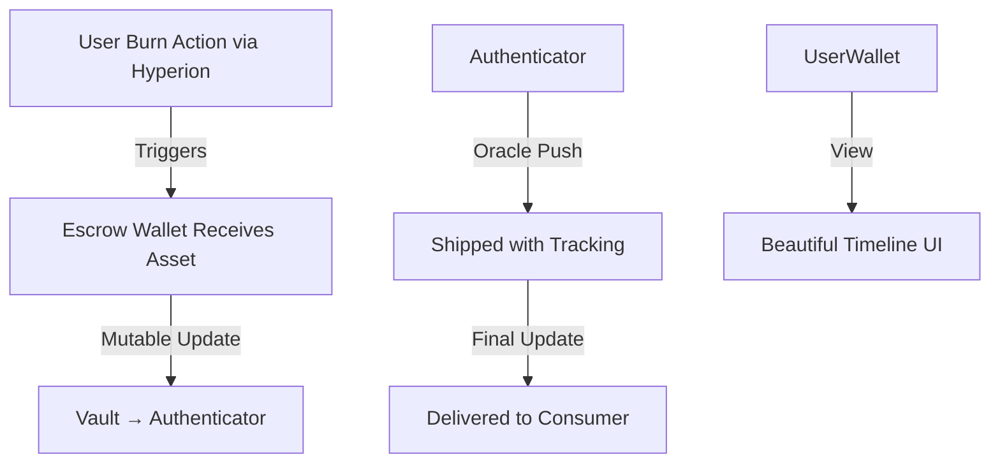

# wax-escrowed-merch-custody-timeline — Phygital Escrowed Merch Custody Timeline

> **Status:** 🔒 Private (In Development) | Target Public Release: August 2026  
> **Category:** Phygital (RWA) Redemptions & Supply-Chain Legibility  
> **Parent Catalog:** [pixel-journey/wax-ecosystem-blueprint-catalog](https://github.com/pixel-journey/wax-ecosystem-blueprint-catalog)

**One-sentence goal:** A transparent data stream and timeline UI that traces the complete journey of physical merchandise custody — from brand vault → independent authenticator → shipping carrier → final consumer — using on-chain signals (burns, transfers, mutable updates) combined with optional off-chain oracle attestations, all without any custom smart contracts.

---

## 1. Overview & Goal

This blueprint provides collectors and brands with a beautiful, auditable timeline of physical merch custody for phygital redemptions on WAX. It solves the trust gap: after a user burns an NFT to claim a hoodie, where is it now? Who has it? When will it arrive?

- **Why it matters:** Phygital projects live or die on delivery trust. Opaque logistics kill repeat business. On-chain transparency (even partial) builds massive goodwill.
- **Public infrastructure only:** AtomicAssets mutable data for custody status updates (signed by brand or escrow service keys), Hyperion for action history (burn → transfer to escrow wallet), optional simple IPFS/HTTPS oracles for carrier tracking numbers pushed as metadata. No custom contracts needed.
- **Target users:** Phygital collectors wanting visibility, brands running fulfillment, escrow/fulfillment partners, secondary buyers assessing delivery risk.
- **Success metrics:** "See full custody chain in one glance", "Reduce 'where is my merch?' tickets by 70%", "Enable trust badges for completed deliveries".

---

## 2. Concepts & Inspiration

- **Core concepts:** Mutable data on AtomicAssets can be updated by authorized keys to reflect real-world status changes (e.g. 'shipped', 'delivered', 'auth verified'). Hyperion streams the burn/transfer events that trigger custody handoffs. Escrow wallets act as on-chain waypoints.
- **Pain points:** Users burn and wait in the dark. Brands get support overload. No public proof of legitimate fulfillment process.
- **Inspirations:** UPS/FedEx tracking pages + blockchain explorers (Etherscan tx timelines) + Notion project timelines. Web3 version: on-chain provenance meets real logistics visibility.
- **Cross-references:** Perfect pair with `wax-phygital-redemption-milestone-stepper` (the on-chain status stepper), `wax-encrypted-shipping-memo-builder` (claim initiation), `wax-rwa-certificate-authenticity-verifier` (final verification step). Complements the entire innovative Category 1 phygital set.

---

## 3. Design Specifications (Pixel Journey Standards)

### 3.1 Visual & Interaction Design
- Vertical timeline with milestone cards (Vault → Authenticator → Carrier → Delivered), each with status icon, timestamp/block height, and expandable details.
- Color: Indigo for on-chain events, emerald for physical handoffs, amber for pending.
- Subtle animations: Progress line fills as steps complete; hover shows exact tx hash or oracle update.
- Responsive: Collapses to compact list on mobile with tap-to-expand.
- Empty state: 'No active redemptions — connect wallet or browse collections' with beautiful illustration.

### 3.2 Key Views / Components
- `CustodyTimeline.tsx` — Main vertical stepper with live updates.
- `CustodyEventCard.tsx` — Individual milestone with icon, description, proof links (tx hash, IPFS metadata).
- `EscrowWalletMonitor.tsx` — Sidebar showing current assets in escrow wallet + expected handoff signals.
- `OracleUpdateForm.tsx` (brand view) — Simple form for authorized keys to push custody updates via WharfKit.

### 3.3 Accessibility (A11y) & Inclusive Design
- WCAG 2.2 AA: Semantic timeline HTML, aria-current on active step, keyboard navigation through events.
- Screen reader: Announces each custody change with context ('Item moved from Vault to Authenticator at block 12345678').
- High contrast icons + text labels.
- Reduced motion option for timeline progress.

### 3.4 Performance & Optimization Targets
- Fast initial load via React Query + cached Hyperion queries.
- Real-time feel via polling or optional WebSocket to Hyperion (if available) or simple refetch on focus.
- Bundle optimized; heavy history via pagination + virtual list if many events.

---

## 4. Technical Architecture

### 4.1 Core Tech Stack
- Next.js 15 + TS + Tailwind + shadcn/ui + framer-motion
- @tanstack/react-query + zod
- @wharfkit/session for brand update signing (demo)
- AtomicAssets + Hyperion for events and mutable data
- Recharts or CSS for timeline; lucide-react icons

### 4.2 Data Flow Diagram


### 4.3 Folder Structure
```
app/
├── (dashboard)/page.tsx
├── components/
│   ├── timeline/
│   │   ├── CustodyTimeline.tsx
│   │   └── CustodyEventCard.tsx
│   └── escrow/
│       └── EscrowMonitor.tsx
├── hooks/useCustodyTimeline.ts
├── lib/wax/
│   ├── hyperion-client.ts
│   └── mutable-parser.ts
└── types/custody.ts
```

### 4.4 Security & Privacy
- Client-side only for viewing.
- Brand updates require WharfKit signature from authorized key (demo shows warning).
- No PII in on-chain data; tracking numbers can be encrypted or hashed if sensitive.

---

## 5. Implementation Examples

**Core hook for timeline data**
```ts
// hooks/useCustodyTimeline.ts
export function useCustodyTimeline(assetId: string) {
  return useQuery({
    queryKey: ['custody', assetId],
    queryFn: async () => {
      const events = await fetchHyperionActions(assetId); // burns, transfers to escrow
      const mutableUpdates = await fetchMutableHistory(assetId);
      return mergeIntoTimeline(events, mutableUpdates);
    }
  });
}
```

**Timeline rendering (simplified)**
```tsx
<CustodyTimeline events={events} />
// Inside: vertical divs with connecting line, status icons from lucide (Package, Truck, CheckCircle)
```

---

## 6. Demo & Testing
- Mock Data mode with sample phygital hoodie journey.
- Live mode pulling real (or testnet) Atomic + Hyperion data.
- Playwright flows for expanding timeline steps.
- Brand demo: Connect authorized key → push custody update → see live UI refresh.

---

## 7. Roadmap
**Phase 0-1:** Scaffold + data layer (Hyperion + mutable parsing).
**Phase 2:** Timeline UI + event cards + responsive.
**Phase 3:** Polish, a11y, brand update form integration.
**Phase 4:** Full docs, screenshots, catalog update.

**Future:** Integration with shipping APIs (optional oracle), multi-item batch views, exportable custody receipts.

---

## 8. Visual References
> Clean vertical timeline like Linear.app or GitHub commit history meets logistics tracking (Shopify + UPS). Each step has subtle glow when completed on-chain. Reference images: typical NFT project delivery trackers + blockchain tx visualizers.

---

## 9. Related Blueprints
- `wax-phygital-redemption-milestone-stepper` — Core on-chain status companion.
- `wax-encrypted-shipping-memo-builder` — For initiating the claim that starts the custody clock.
- `wax-rwa-certificate-authenticity-verifier` — Final physical verification milestone.

---

## 10. License & Credits
MIT. Built for WAX public infrastructure. Thanks to Atomic Hub & Hyperion providers.

**Pixel Journey — Beautiful interfaces for public blockchain data.**
